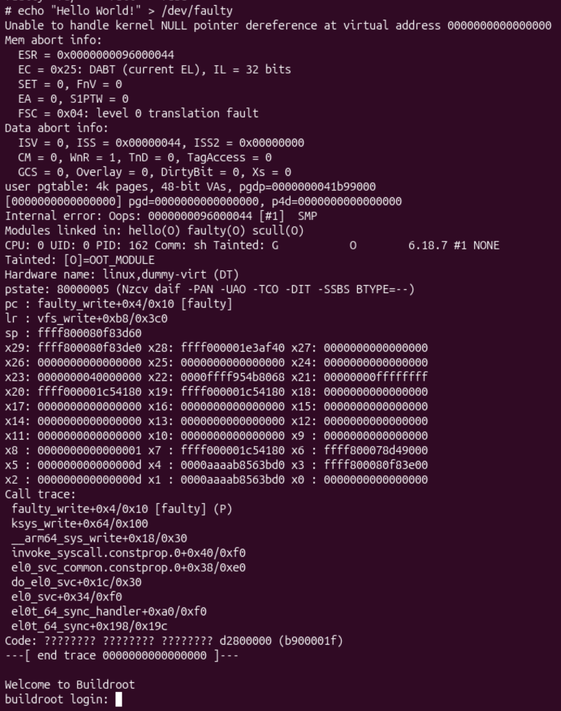

# Kernel Oops Analysis: Writing to `/dev/faulty`

## Trigger and Console Evidence

Running `echo "Hello World!" > /dev/faulty` in the Buildroot AArch64 guest triggers a kernel **Oops** (`Internal error: Oops: 0000000096000044 [#1] SMP`) inside `faulty_write`.

Key console lines:

- `Unable to handle kernel NULL pointer dereference at virtual address 0000000000000000`
- `pc : faulty_write+0x4/0x10 [faulty]`
- `lr : vfs_write+0xb8/0x3c0`
- `Call trace:` starts at `faulty_write+0x4/0x10 [faulty]` reached via `ksys_write` -> `__arm64_sys_write` -> `el0_svc_common` -> `el0t_64_sync_handler`.

## Memory Abort & Fault Decode (`ESR_EL1`)

- **`ESR = 0x0000000096000044`**
  - **`EC = 0x25` (`DABT (current EL)`)**: Data Abort taken from the current Exception Level (EL1 kernel mode).
  - **`IL = 32 bits`**: Faulting instruction is a standard 32-bit AArch64 instruction.
  - **`WnR = 1`** (`ISS = 0x00000044`, bit 6 set): The abort was caused by a **write** access rather than a read.
  - **`FSC = 0x04`**: **Level 0 translation fault**, meaning the virtual address (`0x0000000000000000`) has no valid page table mapping starting at PGD (`pgd=0000000000000000`).

## AArch64 Instruction & Register Analysis

- **`pc : faulty_write+0x4/0x10 [faulty]`**: The fault occurs 4 bytes into a `0x10`-byte (4-instruction) `faulty_write` function.
- **Disassembly / `Code:`**: `d2800000` (`mov x0, #0`) followed by `b900001f` (`str wzr, [x0]`) at `pc` (`faulty_write+0x4`):
  1. `mov x0, #0` (`d2800000`) loads `0` into general-purpose register `x0`.
  2. `str wzr, [x0]` (`b900001f`) attempts to store the 32-bit zero register `wzr` to the memory address held in `x0` (`0x0`), causing the write fault at `0x0000000000000000`.
- **Registers**:
  - `x0 = 0000000000000000` (target null pointer being written to).
  - `x1 = 0000aaaab8563bd0` and `x2 = 000000000000000d` (`13` bytes: `"Hello World!\n"`).
  - `lr = ffff800080...` (`vfs_write+0xb8/0x3c0`), showing `vfs_write` called `faulty_write`.

## Impact and Taint State

- **Tainted kernel (`Tainted: [O]=OOT_MODULE`)**: Expected because out-of-tree modules (`scull`, `faulty`, `hello`) are loaded.
- Because the fault happens in kernel context (`EL1`) while writing to address `0`, the kernel kills the faulting user task (`sh`, PID `162`) and logs the Oops trace. Make sure `oops.png` is placed in the same directory as `analysis.md` so the relative link `./oops.png` resolves.
